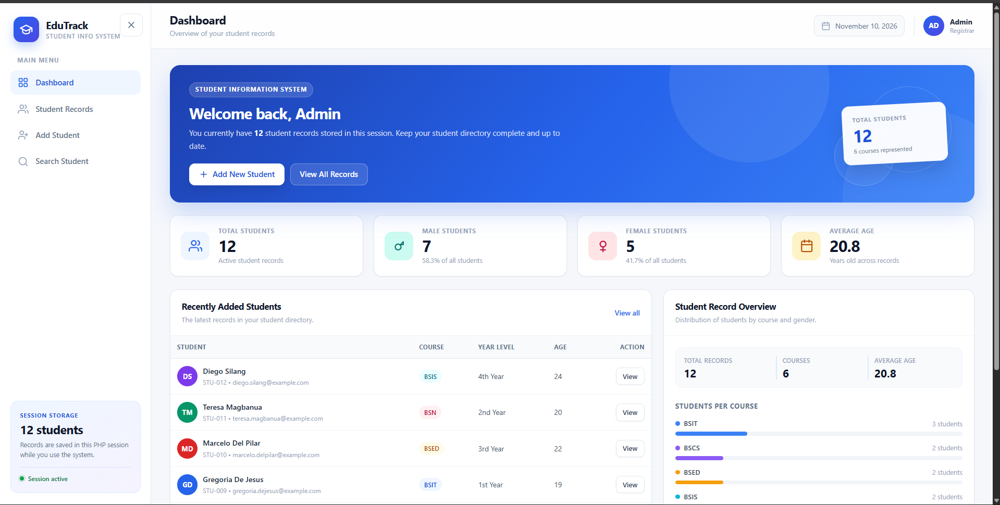
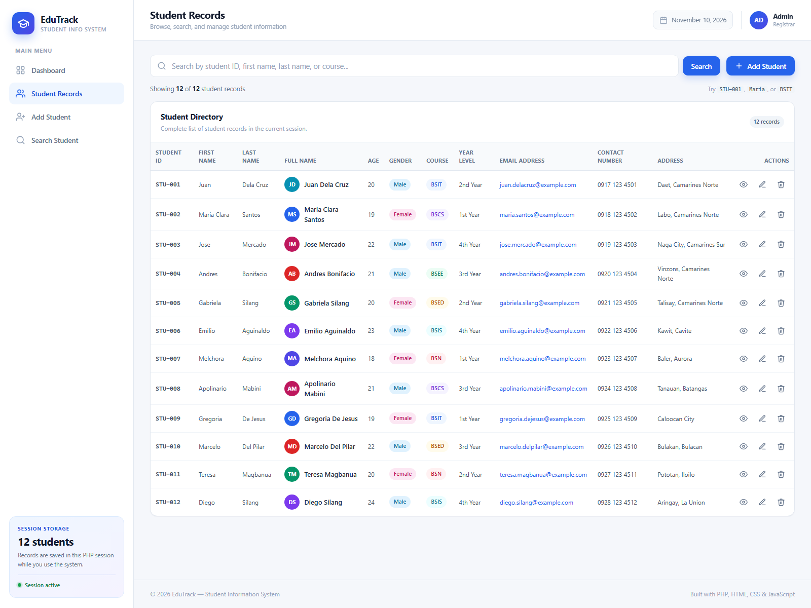
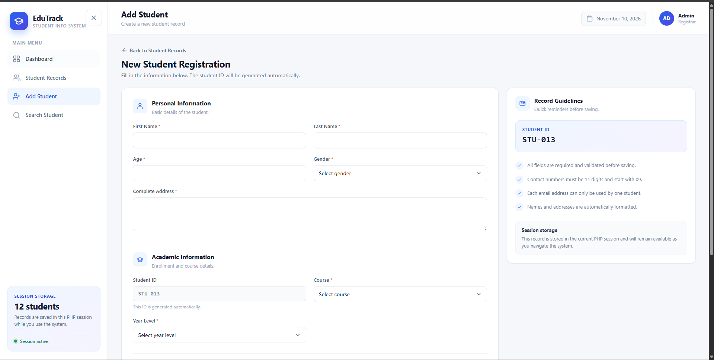
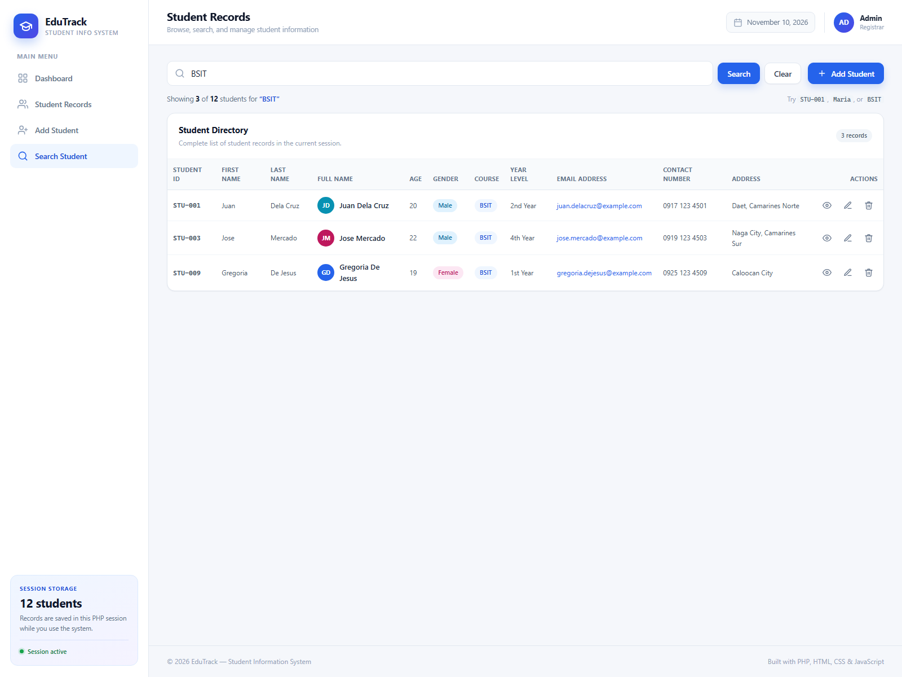
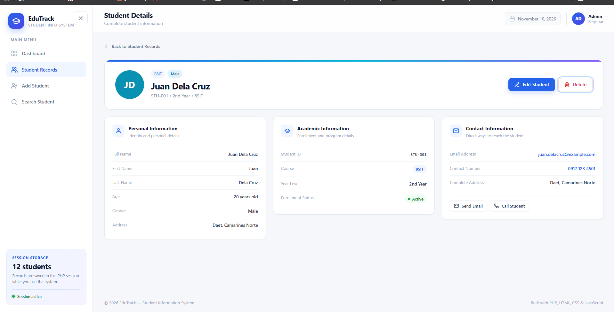
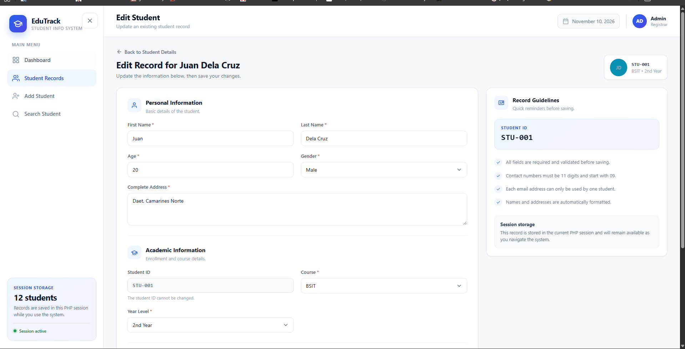
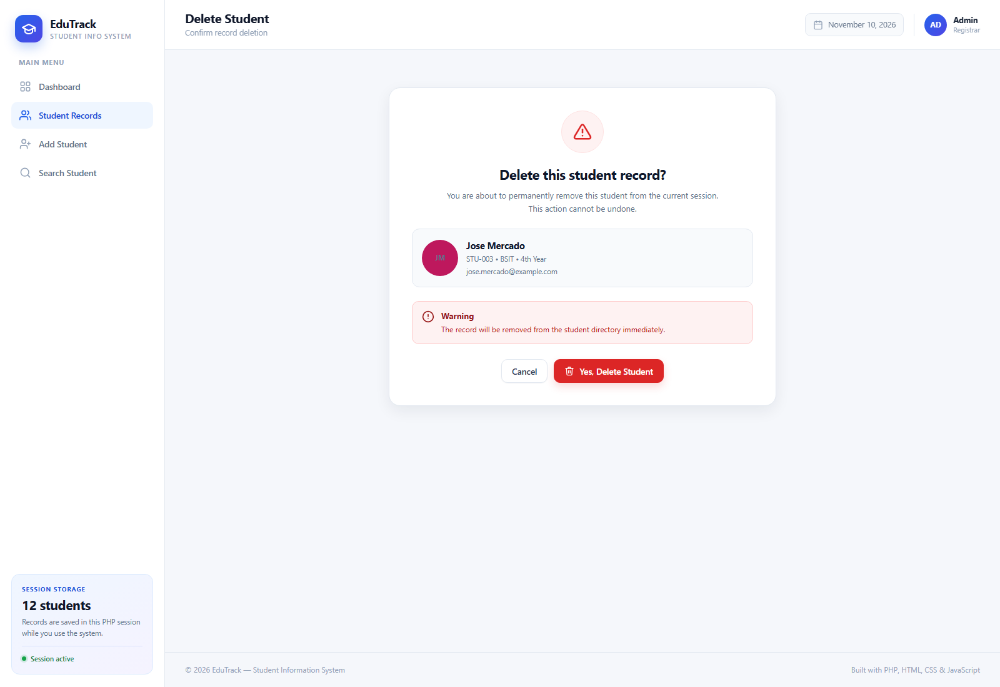

# Student Information System

A complete, database-free Student Information System built with PHP, HTML, CSS, and JavaScript. The project demonstrates associative arrays, reusable PHP functions, string manipulation, session storage, server-side validation, and a modern responsive dashboard.

The application is designed for academic submission and can be run locally with XAMPP. All student records are kept in a PHP associative array and persisted between page requests using PHP sessions, so MySQL is not required.

---

## Table of Contents

- [Project Description](#project-description)
- [Features](#features)
- [PHP Concepts Demonstrated](#php-concepts-demonstrated)
- [Screenshots](#screenshots)
- [Project Structure](#project-structure)
- [Requirements](#requirements)
- [Installation with XAMPP](#installation-with-xampp)
- [Running with PHP's Built-in Server](#running-with-phps-built-in-server)
- [How to Use](#how-to-use)
- [Validation Rules](#validation-rules)
- [Testing Checklist](#testing-checklist)
- [GitHub Repository](#github-repository)
- [Author](#author)

---

## Project Description

Students frequently need a centralized record-keeping tool for enrollment details, academic information, and contact information. This project provides a clean student management dashboard where a registrar or administrator can:

- View live statistics about the student population.
- Browse a complete student directory.
- Add, search, view, update, and delete student records.
- Keep changes available across pages during the active PHP session.

The system ships with 12 sample student records and uses no external frameworks or database. Everything is implemented with plain PHP, CSS, and JavaScript so the source code remains readable and beginner-friendly.

---

## Features

### Dashboard

- Dynamically calculated total number of students.
- Male and female student counts with percentages.
- Average student age.
- Recently added students list.
- Student record overview with:
  - Total records.
  - Number of represented courses.
  - Average age.
  - Students per course with progress bars.
  - Gender distribution bar.

### Student Records

- Organized HTML table with all required fields:
  - Student ID, first name, last name, full name.
  - Age, gender, course, year level.
  - Email address, contact number, address.
- 12 sample student records.
- View, edit, and delete actions for every record.
- Responsive table that becomes a labeled card layout on smaller screens.

### Add Student

- Full registration form with personal, academic, and contact sections.
- Required field validation.
- Age range validation.
- Email format and uniqueness validation.
- Contact number validation.
- Automatic student ID generation.
- Success notification after saving.
- New records are appended to the PHP session array.

### Search Student

- Search by student ID, first name, last name, full name, or course.
- Case-insensitive matching.
- Match highlighting in the full name column.
- Result count and empty-state handling.
- Search results are produced with PHP string functions.

### Student Details

- Profile header with avatar initials, course, year level, and gender.
- Personal information section.
- Academic information section.
- Contact information section.
- Clickable email and phone links.
- Edit, delete, and back navigation actions.

### Edit Student

- Pre-filled form with the selected student's existing data.
- Same validation rules as the add form.
- Student ID is preserved and cannot be changed.
- Success notification after updating.

### Delete Student

- Delete confirmation modal on the records and details pages.
- Dedicated confirmation page for direct links and non-JavaScript use.
- Flash message after successful deletion.
- Removed records are deleted from the session array.

### Interface and Interaction

- Responsive sidebar navigation with mobile drawer.
- Sticky top bar.
- Modern cards, buttons, badges, tables, forms, toasts, and modal dialog.
- Auto-dismissing notifications.
- Escape-key support for closing the modal and mobile sidebar.
- Client-side contact number input filtering.
- Accessible labels, focus states, and reduced-motion support.

---

## PHP Concepts Demonstrated

### Associative Arrays

Every record is an associative array with named keys such as `id`, `first_name`, `last_name`, `age`, `gender`, `course`, `year_level`, `email`, `contact`, and `address`. The full collection is an indexed array of these associative arrays.

### Reusable PHP Functions

| Function | Purpose |
| --- | --- |
| `getStudents()` | Initializes and returns the session student array. |
| `saveStudents()` | Saves the updated student array back to the session. |
| `countStudents()` | Counts all student records. |
| `countByGender()` | Counts students by gender. |
| `averageAge()` | Computes the average student age. |
| `countByCourse()` | Groups and counts students per course. |
| `percentage()` | Computes a safe percentage for dashboard bars. |
| `formatFullName()` | Builds a formatted full name. |
| `getInitials()` | Creates avatar initials. |
| `generateStudentId()` | Generates the next unused `STU-###` ID. |
| `getStudentById()` | Finds a student record by ID. |
| `getStudentIndexById()` | Finds a record's array index for updates and deletion. |
| `searchStudents()` | Searches records by ID, name, or course. |
| `getRecentStudents()` | Returns the latest records for the dashboard. |
| `formatContact()` | Formats an 11-digit contact number for display. |
| `normalizeStudentData()` | Cleans and formats submitted data. |
| `validateStudentData()` | Validates form input and returns field errors. |
| `setFlash()` / `getFlash()` | Stores and displays one-time notifications. |
| `e()` | Escapes output with `htmlspecialchars()`. |

### String Functions

| Function | Where It Is Used |
| --- | --- |
| `strtoupper()` | Student ID display, initials, and course normalization. |
| `strtolower()` | Email normalization, names, search, and avatar color seeds. |
| `ucwords()` | Full names and addresses are displayed in title case. |
| `trim()` | All submitted fields are cleaned before validation and storage. |
| `strlen()` | Name, contact number, and address length validation. |
| `strpos()` | Case-insensitive search uses lowercased text plus `strpos()`. |
| `substr()` | Initials and contact number formatting. |
| `str_pad()` | Zero-padded student IDs. |
| `preg_replace()` | Contact number digit filtering and search highlighting. |
| `strcasecmp()` | Case-insensitive ID and email comparison. |

### Other Required PHP Concepts

- PHP sessions for persistent changes between requests.
- Server-side validation with detailed field errors.
- Flash messages with the Post/Redirect/Get pattern.
- `htmlspecialchars()` output escaping on every displayed value.
- No database required.

---

## Screenshots

### 1. Dashboard



### 2. Student Records Table



### 3. Add Student Form



### 4. Search Functionality



### 5. Student Details Page



### 6. Edit Student Functionality



### 7. Delete Student Confirmation



---

## Project Structure

```text
student-information-system/
|
|-- index.php                  Dashboard and dynamic statistics
|-- students.php               Student directory and search
|-- add-student.php            Add-student form and processing
|-- edit-student.php           Edit-student form and processing
|-- student-details.php        Complete student information page
|-- delete-student.php         Delete confirmation and processing
|-- functions.php              Reusable PHP helper functions
|-- data.php                   Initial associative array of 12 students
|-- README.md                  Project documentation
|
|-- includes/
|   |-- header.php             Page head, top bar, and layout opening
|   |-- sidebar.php            Sidebar navigation
|   |-- footer.php             Footer, delete modal, toast, and scripts
|   `-- student-form.php       Shared add/edit student form
|
`-- assets/
    |-- css/
    |   `-- style.css          Full responsive stylesheet
    |-- js/
    |   `-- script.js          Sidebar, modal, toast, and input behavior
    `-- images/
        |-- dashboard.png
        |-- student-records.png
        |-- add-student.png
        |-- search.png
        |-- student-details.png
        |-- edit-student.png
        `-- delete-confirmation.png
```

---

## Requirements

- XAMPP with PHP 8.0 or newer.
- Apache web server.
- A modern web browser.
- No MySQL database or Composer dependencies are required.

PHP 8.2.12 was used during development and testing.

---

## Installation with XAMPP

1. Install [XAMPP](https://www.apachefriends.org/) if it is not already installed.
2. Copy the entire project folder into the XAMPP `htdocs` directory:

   ```text
   C:\xampp\htdocs\student-information-system\
   ```

   If the folder is currently named something else, rename it to `student-information-system`.

3. Open the XAMPP Control Panel.
4. Start the **Apache** module.
5. Open a browser and visit:

   ```text
   http://localhost/student-information-system/
   ```

6. The dashboard should load with 12 sample student records.

> If you place the project directly in `htdocs` without a subfolder, use `http://localhost/` instead.

### Resetting the sample data

The application stores changes in the current PHP session. To return to the original 12 sample records:

- Close the browser to end the session and open the application again, or
- Clear the site's cookies/session in the browser, or
- Restart Apache and use a new browser session.

---

## Running with PHP's Built-in Server

If PHP is available from the command line, the project can also be started without Apache:

```bash
cd student-information-system
php -S localhost:8000
```

Then visit:

```text
http://localhost:8000/
```

The application requires PHP's session extension, which is enabled by default in standard PHP and XAMPP installations.

---

## How to Use

### Dashboard

Open `index.php` or click **Dashboard** in the sidebar. All statistics are calculated from the current session student array.

### View and Search Records

1. Click **Student Records** or **Search Student** in the sidebar.
2. Type a student ID, first name, last name, or course into the search bar.
3. Click **Search**.
4. Click **Clear** to return to the full directory.

Example searches:

```text
STU-001
Maria
BSIT
```

### Add a Student

1. Click **Add Student**.
2. Fill in all required fields.
3. The Student ID is generated automatically.
4. Click **Save Student**.
5. A success notification appears and the new record is added to the directory.

### View Student Details

Click the eye icon in the student table or the **View** button in the dashboard's recent students list.

### Edit a Student

1. Click the pencil icon in the records table, or **Edit Student** on the details page.
2. Update the desired fields.
3. Click **Save Changes**.
4. A success notification appears with the updated information.

### Delete a Student

1. Click the trash icon in the records table, or **Delete** on the details page.
2. Review the confirmation modal.
3. Click **Delete Student** to confirm, or **Cancel** to keep the record.
4. Without JavaScript, the delete link opens a full confirmation page with the same option.

---

## Validation Rules

| Field | Rule |
| --- | --- |
| First Name | Required, at least 2 characters, letters and common name characters only. |
| Last Name | Required, at least 2 characters, letters and common name characters only. |
| Age | Required, whole number between 15 and 100. |
| Gender | Required, must be Male, Female, or Other. |
| Course | Required, must be one of the offered courses. |
| Year Level | Required, must be a valid year level. |
| Email | Required, valid email format, and unique across all student records. |
| Contact Number | Required, exactly 11 digits, must start with `09`. |
| Address | Required, at least 5 characters. |

All errors are displayed inline below the corresponding field. Success and error notifications are shown as dismissible toasts after redirects.

---

## Testing Checklist

- [x] Dashboard statistics are calculated correctly.
- [x] 12 sample student records are available.
- [x] Adding a student works and generates a new ID.
- [x] Editing a student works and preserves the student ID.
- [x] Deleting a student works with confirmation.
- [x] Search works for ID, first name, last name, and course.
- [x] Search is case-insensitive.
- [x] Student details display all information.
- [x] Duplicate email addresses are rejected.
- [x] Invalid age, email, and contact values are rejected.
- [x] Required field validation is implemented.
- [x] PHP associative arrays are used for all records.
- [x] Reusable PHP functions are implemented and reused.
- [x] Required string functions are demonstrated.
- [x] Output is escaped with `htmlspecialchars()`.
- [x] All sidebar and page navigation links work.
- [x] All action buttons work.
- [x] The interface is responsive on desktop, tablet, and mobile.
- [x] No PHP errors or warnings appear during testing.

---

## GitHub Repository

Replace the placeholder below with the final repository URL before submitting:

```text
https://github.com/your-username/student-information-system
```

Recommended repository name:

```text
student-information-system
```

The repository is ready to upload as-is. It contains all PHP source files, CSS, JavaScript, screenshots, and this README.

Suggested Git commands:

```bash
git init
git add .
git commit -m "Add complete Student Information System project"
git branch -M main
git remote add origin https://github.com/your-username/student-information-system.git
git push -u origin main
```

---

## Author

**Student Name:** Your Name  
**Course / Section:** Your Course and Section  
**School:** Your School  
**Instructor:** Your Instructor  
**Academic Year:** 2026-2027

---

## License

This project was created for academic and educational purposes.
